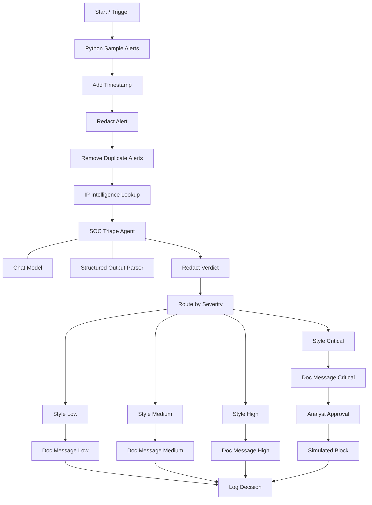

# SOC Alert Triage & Response Bot (NGP-004)

An n8n-based cybersecurity automation project that demonstrates how security alerts can be prepared, enriched, triaged with an AI model, routed by severity, and recorded for review.

> **Project status:** Demonstration workflow using sample alerts. The current workflow should not be described as connected to a live SIEM unless a real alert source and webhook/integration have been configured.

## Overview

Security Operations Center (SOC) analysts receive alerts from many sources. This project demonstrates a workflow to organize alert data and support an initial triage decision. It adds a timestamp, redacts selected sensitive data, removes duplicate alerts, looks up IP intelligence, asks an AI triage agent to assess the alert, and routes the result according to severity.

The workflow is designed to support analysts—not replace their judgment. Critical actions are represented as a simulated response and should require analyst approval.

## Workflow



*Node names and branch behavior depend on the actual n8n node configuration. Adjust this diagram if your saved workflow differs.*

## Node-by-node explanation

1. **Start / Trigger** — Starts a workflow execution.
2. **Python Sample Alerts** — Produces sample security-alert data for testing.
3. **Add Timestamp** — Adds a time value so the alert can be tracked.
4. **Redact Alert** — Removes or masks configured sensitive fields before further processing.
5. **Remove Duplicate Alerts** — Filters repeated alerts according to the configured deduplication logic.
6. **IP Intelligence Lookup** — Retrieves contextual information about an IP address, if a lookup service is configured.
7. **SOC Triage Agent** — Uses an AI model to assess the alert and propose a severity and response.
8. **Structured Output Parser** — Helps format the AI result into the expected structure; valid structure does not guarantee that the assessment is correct.
9. **Redact Verdict** — Masks configured sensitive values in the assessment.
10. **Route by Severity** — Sends the result down the matching Low, Medium, High, or Critical branch.
11. **Style Low / Medium / High / Critical** — Formats a response for the selected severity.
12. **Doc Message nodes** — Produce the configured message or document output.
13. **Analyst Approval** — Adds a human review step for the critical branch.
14. **Simulated Block** — Demonstrates a response action; it does not block a real IP unless deliberately integrated with an authorized security control.
15. **Log Decision** — Records the decision using the configured logging destination.

## Example sample alert

The following example uses the documentation-reserved IP address `192.0.2.50`; it is not evidence of a real attacker.

```json
{
  "alert_id": "SOC-001",
  "event_type": "Multiple Failed Logins",
  "source_ip": "192.0.2.50",
  "username": "admin",
  "failed_attempts": 25
}
```

The AI output and severity depend on the prompt, model, parser schema, and routing rules configured in n8n.

## How to run the workflow

1. Open your n8n instance and open this workflow.
2. Check that the sample-alert node, AI model credentials, parser, and any IP-intelligence credentials are configured.
3. Click **Execute Workflow**.
4. Wait for the execution to finish.
5. Click individual nodes and inspect their **Output** data, especially:
   - `Python Sample Alerts`
   - `IP Intelligence Lookup`
   - `SOC Triage Agent`
   - `Redact Verdict`
   - `Route by Severity`
   - `Log Decision`
6. Open the **Executions** tab to review saved workflow runs and node outputs.

### Receiving real alerts

The sample-alert node is for testing. To receive alerts from Wazuh or another SIEM, configure an appropriate **Webhook** or supported integration, validate the incoming payload, and connect it to the processing steps. Use the production webhook URL only after testing and securing the endpoint. The workflow does not receive live SIEM alerts just because the sample workflow runs successfully.

## Security and safety considerations

- **Protect secrets:** Keep API keys, tokens, and credentials in n8n credentials or environment secrets. Never commit them to GitHub.
- **Redact data:** Configure redaction for usernames, email addresses, tokens, and other sensitive fields as appropriate.
- **Verify enrichment:** IP reputation is contextual information, not proof that an address is malicious.
- **Validate AI results:** Treat AI output as a recommendation. Validate its schema and check its reasoning against the event data.
- **Require human approval:** Review critical alerts before taking real containment actions.
- **Keep responses simulated by default:** Do not connect blocking or destructive actions to production systems without authorization, safeguards, logging, and testing.
- **Avoid real personal data:** Use synthetic or sanitized alerts in demos and screenshots.

## Tools and technologies

- **n8n** — Workflow automation
- **Python** — Sample alert generation or data processing, depending on node implementation
- **AI chat model** — Alert triage assistance
- **IP intelligence service** — Optional enrichment, if configured
- **Structured output parser** — Consistent AI response format

## Limitations

- AI-generated severity and recommendations may be incorrect.
- IP intelligence may be unavailable, stale, or incomplete.
- Deduplication depends on the configured matching key and time window.
- Message/document and logging nodes only persist or send data if their destinations are configured.
- The simulated block step does not perform real network blocking by itself.
- Live SIEM integration requires additional setup and testing.

## Future improvements

- Integrate a Wazuh or other SIEM webhook.
- Add schema validation and error-handling branches.
- Store triage history in a database or approved case-management system.
- Add analyst feedback so triage rules can be evaluated and improved.
- Add workflow tests for duplicate events, missing fields, malformed payloads, and each severity branch.
- Add monitoring for failed executions and external API errors.

## Disclaimer

This project is intended for learning and authorized defensive-security testing. Use only systems, data, and integrations you are authorized to access. Do not enable real blocking or other production response actions without appropriate approval and safeguards.
